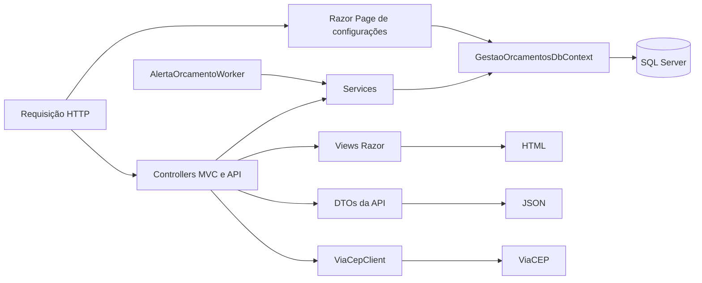
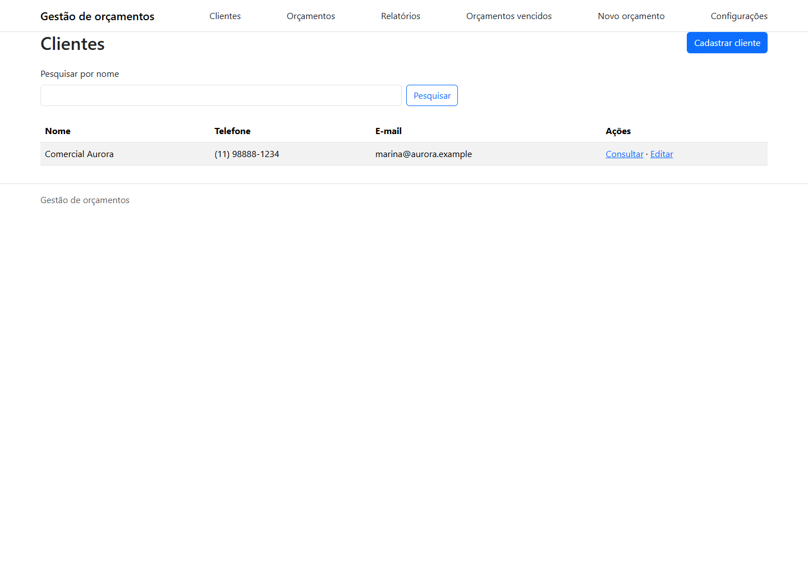
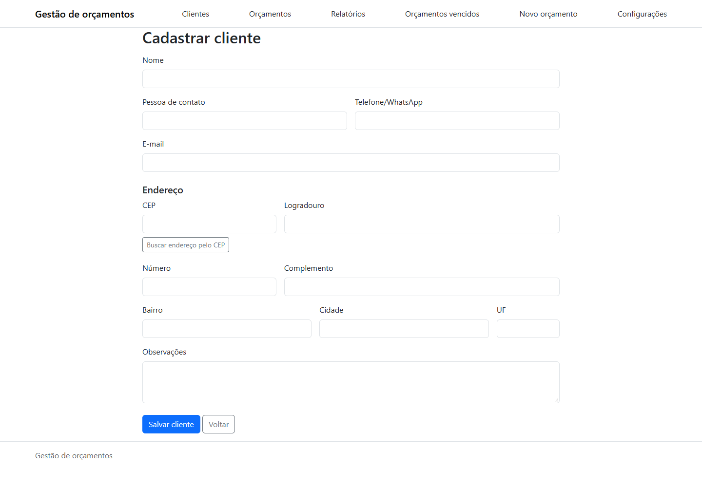
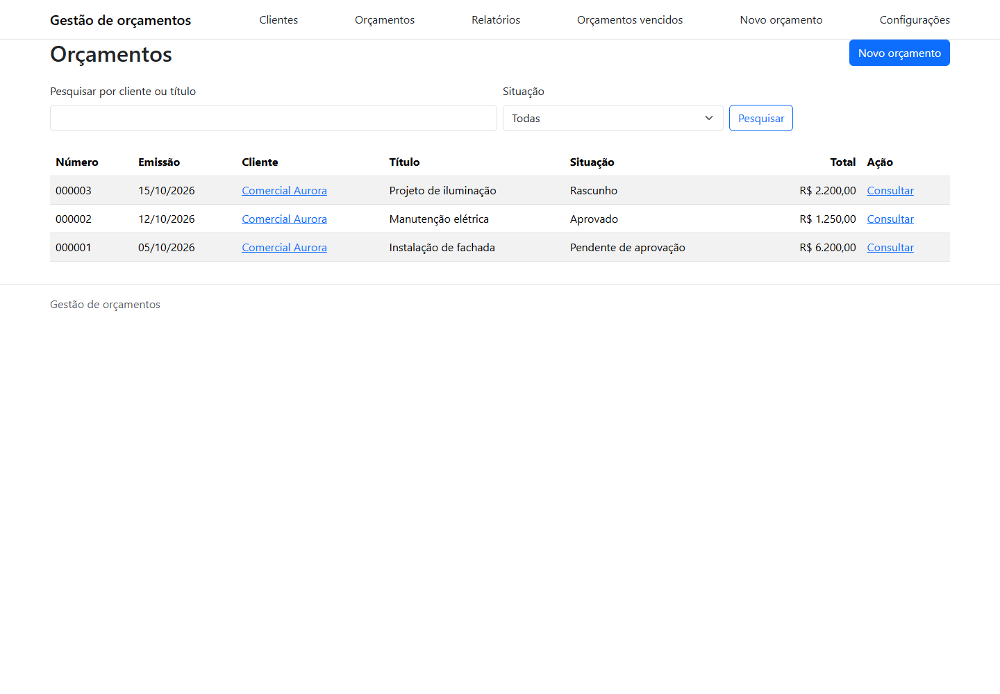
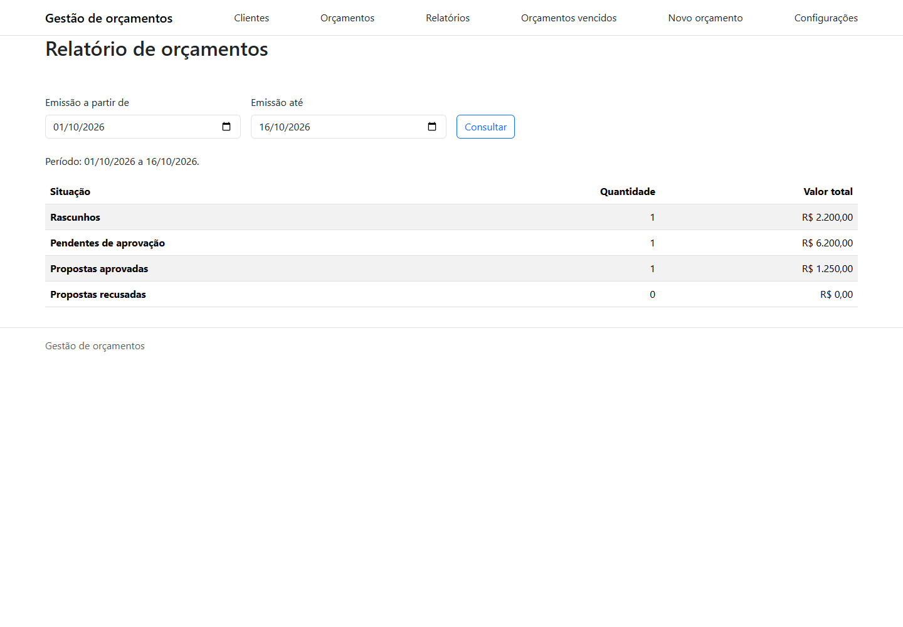
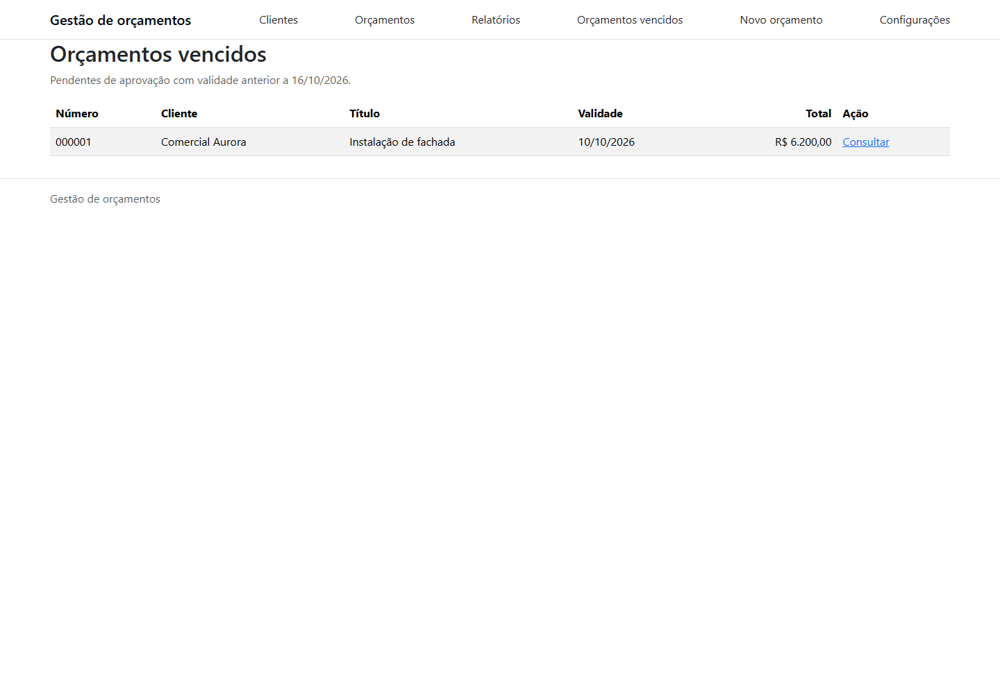

# Gestão de orçamentos

Esta aplicação vem para organizar clientes e acompanhar orçamentos, desde a criação até a aprovação ou recusa.

O fluxo também guarda os dados do cliente e do negócio que foram apresentados quando a proposta foi enviada, para que depois as alterações nos cadastros não mudem o histórico.

A proposta do projeto é resolver esse fluxo de trabalho e demonstrar, em uma aplicação funcional, como estes recursos do ASP.NET Core e do SQL Server podem trabalhar juntos:

- MVC e Razor Pages;
- API HTTP;
- Persistência com Entity Framework Core;
- Consultas SQL
- Tarefas em segundo plano
- Integração com um serviço externo.

O aplicativo foi pensado para uso pessoal no próprio computador, sem login, além disso, o servidor escuta em interfaces de loopback e a aplicação usa `pt-BR`.

## O que a aplicação faz?

- Cadastra, pesquisa, consulta e edita clientes; impede sua exclusão quando há orçamentos vinculados;
- Mantém os dados do negócio usados nas propostas;
- Cria orçamentos com itens, quantidades, unidades e preços, calcula totais e acompanha as mudanças de situação;
- Apresenta relatórios por período, registra avisos de validade e prepara orçamentos para impressão ou PDF;
- Oferece endpoints HTTP para consulta de clientes e consulta de endereços pelo ViaCEP.

## Arquitetura e escolhas técnicas

É um único aplicativo ASP.NET Core em .NET 10, organizado em camadas dentro do mesmo projeto. A apresentação recebe requisições e monta respostas; serviços coordenam os fluxos da aplicação; o acesso a dados usa Entity Framework Core e SQL Server LocalDB no ambiente de desenvolvimento.

As pastas agrupam responsabilidades que colaboram nesses fluxos:

- `Controllers` tratam requisições MVC e da API;
- `Pages` contém a página Razor Pages de configurações, e `Views` contém as telas Razor dos controllers MVC;
- `Services` implementa operações de clientes, orçamentos, relatórios, alertas e a integração com o ViaCEP;
- `Models` reúne entidades persistidas, modelos de formulário e de tela, e DTOs da API em `Models/Api`;
- `Data` contém o `GestaoOrcamentosDbContext` e as migrations do Entity Framework Core;
- `wwwroot` contém CSS, JavaScript e outros arquivos estáticos da interface.

O fluxo mais comum parte de um controller, passa por um serviço e chega ao banco pelo `DbContext`. A página de configurações usa o `DbContext` diretamente. As respostas MVC são renderizadas pelas Views, e as respostas da API são serializadas como JSON.



[Navegue por este diagrama](https://dataxstudios.com.br/br/apps/markdown-studio/#c=VZBBbsIwEEX3PcVoVu2CK1QKDhDS0LhJRBcjFm4YqNU0bm1Tql6nC07QE-RiVUxAsBv9__znjzeN2devynrIihsAgIiw4M-ddro7dL8GkqqSuILR6B7GhMK03pqmYetgsRTAEMk5ro4vAyQJC_VjLEi1ZVgz1Kbd6O3Oqu7Q_bEb4HGABWHJ9kvXZ10EPSacsfPK5LZW79x64-KXfjd_-wGURzDMcZgndIvlUwZ9Ilu8u1w0JVxq3jsI3YaIabBmhEm1yK56JYRxlTtYq4v7kmDNCdMyf7zC0z5dCf4Qjeb21DAN3sPRm8hBzQijhq1X59OejX1jO_yx-Ac)

### Padrões e modelos

- **MVC e Razor Pages:** controllers tratam requisições e as Views renderizam HTML, já Razor Pages atendem configurações, e os controllers de API retornam JSON.
- **Injeção de dependência:** o contêiner do ASP.NET Core compõe os serviços e define seus ciclos de vida. Os serviços recebem dependências concretas, como `GestaoOrcamentosDbContext`.
- **Unit of Work do Entity Framework Core:** o `DbContext` acompanha alterações e as persiste com `SaveChangesAsync`, e os `DbSet`s dão acesso às entidades.
- **Post/Redirect/Get:** depois de operações de escrita nos formulários MVC, a aplicação redireciona para outra página.
- **Separação de responsabilidades:** controllers cuidam do protocolo HTTP, enquanto serviços concentram fluxos da aplicação. Essa divisão segue o princípio de responsabilidade única no nível dos componentes.
- **Validação e segurança dos formulários:** Data Annotations validam os dados, os serviços repetem a validação antes de gravar e os POSTs MVC usam token antifalsificação.
- **Consultas:** as leituras usam `AsNoTracking`, e operações de banco são assíncronas e recebem o token de cancelamento da requisição.

Os tipos da pasta `Models` têm funções diferentes. Entidades como `Cliente` e `Orcamento` representam dados persistidos e são mapeadas pelo Entity Framework Core. `ClienteFormulario` e `OrcamentoFormulario` recebem e validam dados de entrada, e modelos de tela combinam informações para uma página.

DTO (_Data Transfer Object_) define o formato de dados que atravessa uma fronteira da aplicação. `ClienteDto`, por exemplo, seleciona os campos expostos pela API, enquanto `ClientesPaginaDto` inclui os dados de paginação. Esses DTOs ficam em `Models/Api`, e o cadastro da API reutiliza `ClienteFormulario` como modelo de entrada.

### Persistência e processamento

- `GestaoOrcamentosDbContext` mapeia clientes, configurações, orçamentos e itens. As migrations versionam as alterações do esquema;
- a view SQL `vw_ResumoOrcamentos` calcula os totais para a listagem sem carregar os itens no processo web;
- a procedure `sp_RelatorioOrcamentosPorPeriodo` agrega quantidade e valor por situação;
- a função `fn_OrcamentosVencidos` identifica orçamentos pendentes cuja validade passou. `AlertaOrcamentoWorker` executa o serviço de alertas em segundo plano, com um escopo de DI por ciclo;
- o índice filtrado `IX_Orcamentos_Pendente_Validade` atende à busca dos orçamentos pendentes com validade definida;
- `ViaCepClient` consulta o ViaCEP por meio do cliente HTTP gerenciado pelo ASP.NET Core.

## Fluxo dos orçamentos

- Um orçamento começa como rascunho e pode ser editado ou excluído. O operador pode criá-lo pelo menu ou pela página de um cliente;
- cada subtotal é arredondado para centavos com `decimal` e `AwayFromZero`, e o número apresentado usa o ID do banco com seis dígitos;
- ao enviá-lo para aprovação, a aplicação exige os dados do negócio e registra cópias dos dados do cliente e do negócio;
- enquanto está pendente, o operador pode aprovar, recusar ou devolver o orçamento ao rascunho. A devolução descarta as cópias, e um novo envio registra os dados atualizados;
- orçamentos aprovados ou recusados ficam disponíveis para consulta, sem edição ou exclusão. A consulta usa os dados registrados no envio, mesmo que os cadastros tenham mudado;
- um orçamento pode ser duplicado como novo rascunho. A cópia recebe novo número e data atual, mantém cliente, título, observações e itens, deixa a validade em branco e não copia os dados históricos. Seus itens são independentes do original;
- a impressão apresenta uma versão pronta para impressão ou para salvar em PDF.

O relatório usa a data de emissão e mostra quantidade e valor por situação, inclusive quando uma situação não tem registros no período. A verificação de vencimentos roda na inicialização e a cada minuto, então, registra no máximo um aviso por orçamento que continua pendente e vencido, sem mudar sua situação.

## API de consulta

- `GET /api/clientes?nome=&pagina=1&tamanhoPagina=20`: pesquisa opcional por nome, e a resposta contém `itens`, `pagina`, `tamanhoPagina`, `totalItens` e `totalPaginas`. O tamanho da página aceita valores de 1 a 100;
- `GET /api/clientes/{id}`: retorna um cliente ou `404` quando ele não existe;
- `POST /api/clientes`: cadastra cliente com os mesmos campos e validações da interface e responde `201` com `Location`;
- `GET /api/enderecos/{cep}`: consulta o ViaCEP pelo servidor. O CEP deve conter oito dígitos e a resposta contém os campos de endereço usados no cadastro.

Parâmetros de paginação e dados inválidos retornam `400` com erros por campo. Uma pesquisa sem resultados retorna `itens` vazio. CEP inexistente retorna `404`, e falhas ou timeout do ViaCEP retornam `503`. A consulta de CEP ajuda a preencher o endereço, que também pode ser digitado manualmente.

Em ambiente de desenvolvimento, o documento OpenAPI fica em `/openapi/v1.json`. Para navegar pelos endpoints no Chrome, pode-se usar a [extensão OpenAPI Swaggerizer](https://chromewebstore.google.com/detail/openapi-swaggerizer/lnjdikkckkcpokjbckcgfnmdgikohjhd?authuser=0&hl=pt-BR).

## Medição da consulta de vencimentos

Conforme iremos criar vários orçamentos que nunca serão finalizamos, esta parte do sistema acaba se sendo mais requisitada, repare bem nesta consulta de vencimentos: `SELECT COUNT_BIG(*) FROM dbo.fn_OrcamentosVencidos('2026-10-16')`, fiz uma verificação técnica do efeito do índice `IX_Orcamentos_Pendente_Validade` usando um script de powershell + SQL Server LocalDB com um banco temporário com 100.000 orçamentos fictícios: 5.000 pendentes, dos quais 2.500 vencidos, com e sem o índice, e aqui estão os dados obtidos:

| Estado                | Operador             | Linhas lidas | Leituras lógicas |       CPU / tempo decorrido |
| --------------------- | -------------------- | -----------: | ---------------: | --------------------------: |
| Sem o índice          | Clustered Index Scan |      100.000 |            1.044 |               16 ms / 16 ms |
| Com o índice filtrado | Index Seek           |        2.500 |                7 | 0 ms / 0 ms (menor que 1ms) |

## Imagens da aplicação

As imagens mostram o aplicativo em execução com dados fictícios.











## Requisitos e desenvolvimento

- SDK do .NET 10;
- SQL Server LocalDB.

Confirme que a instância LocalDB está instalada e que a conexão funciona:

```powershell
SqlLocalDB info MSSQLLocalDB
sqlcmd -S '(localdb)\MSSQLLocalDB' -E -Q 'SELECT 1'
```

A conexão de desenvolvimento está em `src/GestaoOrcamentos.Web/appsettings.Development.json` e usa autenticação integrada do Windows. Para criar ou atualizar o banco, use o Console do Gerenciador de Pacotes do Visual Studio, selecionando `GestaoOrcamentos.Web` como projeto padrão:

```powershell
Update-Database
```

No terminal, com `dotnet-ef` instalado globalmente, execute o comando equivalente:

```powershell
dotnet ef database update --project src/GestaoOrcamentos.Web/GestaoOrcamentos.Web.csproj
```

Na raiz do repositório, restaure e inicie o aplicativo:

```powershell
dotnet restore GestaoOrcamentos.slnx
dotnet run --project src/GestaoOrcamentos.Web/GestaoOrcamentos.Web.csproj
```

Abra `http://127.0.0.1:5198` no navegador. Para compilar sem iniciar o servidor:

```powershell
dotnet build GestaoOrcamentos.slnx
```

## Publicar no Windows x64

O perfil `win-x64-local` publica um executável self-contained de arquivo único em `artifacts/publish/win-x64`. O runtime .NET está incluído, e o SQL Server precisa estar instalado separadamente. Configure a conexão por variável de ambiente:

```powershell
dotnet publish src/GestaoOrcamentos.Web/GestaoOrcamentos.Web.csproj -c Release -p:PublishProfile=win-x64-local

$env:ConnectionStrings__GestaoOrcamentos = 'Server=(localdb)\MSSQLLocalDB;Database=GestaoOrcamentos;Trusted_Connection=True;TrustServerCertificate=True'
Set-Location artifacts/publish/win-x64
.\GestaoOrcamentos.Web.exe --migrate
.\GestaoOrcamentos.Web.exe
```

`--migrate` aplica as migrations e encerra com código 0. Em caso de falha, o erro é registrado e o processo retorna código diferente de zero. A inicialização normal não altera o esquema do banco. O endereço padrão é `http://localhost:5198`, já a porta pode ser alterada por `LocalServer__Port`.

## Testes

Execute a suíte xUnit com:

```powershell
dotnet test GestaoOrcamentos.slnx
```

Os testes cobrem validações, consultas, persistência, cálculos SQL e alertas, e os testes de persistência criam e removem um banco LocalDB próprio.
