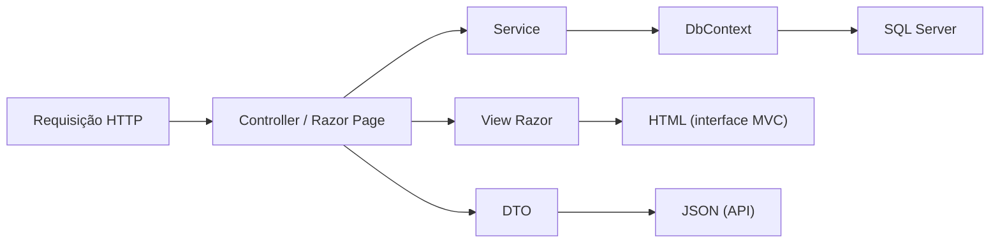
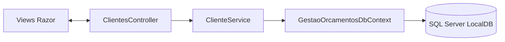

# Gestão de orçamentos

Aplicação web local, sem autenticação, em ASP.NET Core MVC e Razor Pages utilizando Bootstrap.

**Atenção**
Esta aplicação não é preparada para publicação em rede, sendo assim, o servidor HTTP escuta somente em interfaces de loopback.

**O que faz?**
Permite cadastrar, pesquisar, consultar, editar e excluir clientes.
A página de configurações gerencia os dados do negócio.
Também permite criar e pesquisar orçamentos com itens, quantidade, unidade e preço, além de acompanhar aprovação e recusa.

## Arquitetura

É um único aplicativo web ASP.NET Core em .NET 10.

As pastas representam responsabilidades que colaboram no tratamento de cada operação:

- `Controllers` recebem as requisições HTTP e coordenam a resposta da interface MVC ou da API;
- `Pages` e `Views` compõem a interface com Razor: `Pages` atende páginas Razor Pages, enquanto `Views` renderiza as respostas dos controllers MVC;
- `Services` concentram fluxos da aplicação, como validação e persistência de clientes e orçamentos, relatórios, alertas e integração com o ViaCEP;
- `Models` reúnem tipos de dados usados entre essas partes, aqui há entidades persistidas, modelos de formulário e de tela, além dos DTOs da API em `Models/Api`;
- `Data` contém o `DbContext`, o mapeamento do Entity Framework Core e as migrations que versionam o esquema do SQL Server;
- `wwwroot` contém os arquivos estáticos da interface, como CSS e JavaScript.

#### Fluxo típico

Começa no controller ou em uma Razor Page, passa pelo serviço responsável e chega ao banco por meio do `GestaoOrcamentosDbContext`, sendo assim, a resposta segue de volta para uma View Razor (HTML) ou, nos endpoints da API, como JSON.



[Navegue por este diagrama](https://dataxstudios.com.br/br/apps/markdown-studio/#c=VY09DoJAEEZ7TzGZCgrjDUz4URcDgkBsJhRIBt2EsHFFMV7HwoNwMeOKibbvzfumblRfHUvdQZhOAAAcwpRPF3mWw3N4KBB5nmAB0-kcXEJPtZ1WTcMaZpCWd6UhKQ-MhWldc-YRZqyvsvpiz2Cf0N-_e751o_CNWBBm2xDeDWssJj9TS8Kd5P7zaYyWxqwIRR6FYMm2Y12XFUO08-z_XBD6eTx2wqCAcJ3FG7CcJLCxeAE&theme=default)

#### Detalhando mais sobre Entidades, modelos de formulário e DTOs

- Entidades como `Cliente` e `Orcamento` representam dados persistidos e são mapeadas pelo Entity Framework Core;
- Modelos como `ClienteFormulario` recebem e validam os dados enviados pelos formulários;
- Modelos de tela combinam dados para uma página, então eles moldam a interação da interface e não são, por conta disso, as entidades do banco.
- `DTO` é um formato de dados definido para atravessar uma fronteira, neste caso principalmente a resposta JSON da API, por exemplo, `ClienteDto` transforma um `Cliente` em uma resposta pública com os campos escolhidos, e `ClientesPaginaDto` acrescenta os metadados de paginação, com isso separa-se o contrato HTTP do formato interno da entidade, portanto as mudanças na persistência não precisam alterar automaticamente o JSON
- O cadastro da API atualmente reutiliza `ClienteFormulario` como modelo de entrada.

#### Estilo arquitetural e padrões usados

- **Monólito em camadas**: sem projetos separados para esta aplicação e sendo publicada como um único app ASP.NET Core, organizado entre:
  - Apresentação: Controllers, Pages e Views;
  - Serviços;
  - Acesso a dados: `Data`.

- **MVC**: controllers e views Razor separam o tratamento de requisições da renderização HTML, e o projeto também usa Razor Pages para configurações e controllers de API para respostas JSON.

- **Injeção de dependência**: o contêiner do ASP.NET Core compõe os serviços e define seus ciclos de vida, com isso os serviços da aplicação recebem diretamente dependências concretas, como `GestaoOrcamentosDbContext`.

- **Unit of Work e acesso a dados do Entity Framework Core**: o `DbContext` acompanha alterações e as persiste com `SaveChangesAsync` e seus `DbSet` dão acesso às entidades, com isso, o projeto não implementa uma camada própria de repositórios.

- **DTO e Post/Redirect/Get**: DTOs definem formatos de transferência da API, e os formulários MVC redirecionam após operações de escrita.

Esta organização toda é uma arquitetura em camadas dentro de um monólito. A solução nesta fase atual se apoia principalmente nos recursos e padrões do ASP.NET Core e do Entity Framework Core.

Outros detalhes de operação:

- A leitura da lista de orçamentos usa um modelo sem chave alimentado pela view SQL;
- O relatório chama a procedure por ADO.NET;
- Os alertas usam um `BackgroundService` com escopo de DI por ciclo.

### As operações de clientes seguem este fluxo



[Navegue por este diagrama](https://dataxstudios.com.br/br/apps/markdown-studio/#c=PYy9CsIwEIB3n-K4SYe-gTgkAZeAtIEuIUMMJxZiDy6hFZ9eUovz9_PIvKZnlAp2OAAAjB7HidYCQ_ywYIBz111Ae9R5orlS0TxX4ZxJMGyFhma4v-FIlinRTt1GjfJ4pVIj3yTFF82Vi7m3Fb3rbhr1G_XWH9H1FtqIBCynmI3CU_gC&theme=default)

| Parte                        | Responsabilidade                                                                                                                                                                                          |
| ---------------------------- | --------------------------------------------------------------------------------------------------------------------------------------------------------------------------------------------------------- |
| **MVC e Razor**              | O controller recebe as requisições, já as views apresentam listagem, detalhes, formulários e erros.                                                                                                       |
| **Razor Pages**              | A página `/Configuracoes` apresenta e salva os dados do negócio.                                                                                                                                          |
| **Orçamentos MVC**           | Listagem, pesquisa, criação e consulta; `OrcamentoService` valida itens, altera rascunhos e controla as transições de situação.                                                                           |
| **Cálculo de valores**       | Cada subtotal é arredondado para centavos antes da soma do total, usando `decimal` e `AwayFromZero`. O número exibido usa o ID do banco com seis dígitos.                                                 |
| `ClienteFormulario`          | Modelo usado no cadastro e na edição, com validações por Data Annotations, e o serviço também as verifica antes de gravar.                                                                                |
| `ClienteService`             | Pesquisa, consulta, normaliza dados e coordena cadastro, edição e exclusão. É registrado como serviço _scoped_ por injeção de dependência.                                                                |
| **API de clientes**          | Endpoints JSON de consulta usam o mesmo serviço da interface MVC; o cadastro compartilha as validações do formulário. DTOs definem a resposta e a listagem tem paginação.                                 |
| **Resumo de orçamentos**     | A view SQL `vw_ResumoOrcamentos` calcula totais arredondando cada item para centavos e fornece os dados da listagem sem carregar os itens no processo web.                                                |
| **Relatório por período**    | `sp_RelatorioOrcamentosPorPeriodo` agrega quantidade e valor por situação, incluindo as datas inicial e final. Situação aprovada é apresentada como proposta aprovada.                                    |
| **Alertas de validade**      | `fn_OrcamentosVencidos` seleciona somente orçamentos pendentes com validade anterior à data de referência. Um `BackgroundService` usa escopo novo por execução e grava no máximo um alerta por orçamento. |
| **Índice de vencimentos**    | `IX_Orcamentos_Pendente_Validade` é filtrado para pendentes com validade definida e cobre a busca de IDs da função de vencimentos.                                                                        |
| **Entity Framework Core**    | O `DbContext` mapeia clientes, configurações, orçamentos e itens; migrations versionam as tabelas. A configuração possui um único registro, com ID fixo em 1. Cópias cadastrais ficam no orçamento.       |
| **Padrão Post/Redirect/Get** | Após cadastro ou edição, o POST redireciona aos detalhes. Após exclusão, redireciona à listagem de clientes ou ao cliente vinculado. A confirmação usa `TempData`.                                        |

#### Outros detalhes

- Os `POSTs` usam token antifalsificação;
- A exclusão exige uma página de confirmação;
- As consultas usam `AsNoTracking`;
- Operações de banco são assíncronas e recebem o token de cancelamento da requisição;
- A interface é toda em `pt-BR`;
- Bootstrap local e textos em português.
- Os testes xUnit verificam validações, consultas, persistência, cálculos SQL e avisos em bancos LocalDB temporários.

#### Detalhes de alguns fluxos

- **Criar um orçamento**: cadastre um cliente e use `Novo orçamento` no menu ou na página do cliente;
- **Exclusão de clientes**: se ele possuir orçamentos, então será bloqueada pela aplicação e pelo banco;
- **Editar da página de rascunho**: permite alterar os dados e adicionar ou remover itens;
- **Excluir**: exige confirmação;
- **Lista de orçamentos**: permite pesquisar pelo nome do cliente ou pelo título;
- A página de cada cliente mostra seus orçamentos vinculados;
- **Menu de relatórios**: consulta orçamentos pela data de emissão e apresenta quantidade e valor por situação, inclusive categorias sem registros no período;
- **Menu de orçamentos vencidos**: listagem de avisos registrados para propostas que continuam pendentes e cuja validade já passou;
- **Verificação** roda na inicialização e a cada minuto, não altera a situação do orçamento e continua independente da listagem principal.
- **Orçamento** começa como `rascunho`, quando pode ser editado ou excluído;
- Ao marcar orçamento como **pendente de aprovação**, a aplicação exige as configurações do negócio e registra cópias dos dados do cliente e do negócio;
- **Orçamento pendente**: enquanto ele estiver pendente, é possível `aprovar`, `recusar` ou `devolver ao rascunho`;
- **Orçamentos aprovados e recusados**: ficam disponíveis para consulta, sem edição ou exclusão;
- **Aprovação de orçamento e recusa**: são registradas pelo operador da aplicação.
- **Consultas de orçamentos**: as que estão fora de rascunho mostram os dados registrados no envio, mesmo que os cadastros sejam alterados depois;
- **Orçametno devolvido ao rascunho**: descarta as cópias;
- **Orçamento enviado**: quando ocorre um novo envio, registra-se os dados atualizados;
- Qualquer orçamento pode ser duplicado como novo rascunho;
- **Quando há uma cópia de orçamento**: ela recebe outro número e a data atual, mantém cliente, título, observações e itens, e deixa a validade em branco, e seus itens são independentes do original, e os dados históricos registrados não são copiados;
- **Detalhes do orçamento**: `Imprimir ou salvar em PDF` abre uma versão pronta para impressão;
- **Orçamentos rascunhos**: usam os cadastros atuais, já os demais orçamentos usam os dados registrados quando foram marcados como pendentes.

## Medição da performance na parte de vencimentos

Conforme vamos criando vários orçamentos que nunca finalizamos, identifiquei então como um possível gargalo nesta consulta de vencimentos: `SELECT COUNT_BIG(*) FROM dbo.fn_OrcamentosVencidos('2026-10-16')`, fiz uma verificação técnica do efeito do índice usando um script de powershell + SQL Server LocalDB com um banco temporário com 100.000 orçamentos fictícios: 5.000 pendentes, dos quais 2.500 vencidos, com e sem o índice, e vejam os dados obtidos:

| Estado                | Operador             | Linhas lidas | Leituras lógicas |       CPU / tempo decorrido |
| --------------------- | -------------------- | -----------: | ---------------: | --------------------------: |
| Sem o índice          | Clustered Index Scan |      100.000 |            1.044 |               16 ms / 16 ms |
| Com o índice filtrado | Index Seek           |        2.500 |                7 | 0 ms / 0 ms (menor que 1ms) |

## API de consulta de clientes

- `GET /api/clientes?nome=&pagina=1&tamanhoPagina=20`: a pesquisa é opcional por nome, e a resposta contém `itens`, `pagina`, `tamanhoPagina`, `totalItens` e `totalPaginas`, já o tamanho da página deve ser de 1 a 100.
- `GET /api/clientes/{id}`: retorna os dados de um cliente ou `404` se não existir.
- `POST /api/clientes`: cadastra cliente com os mesmos campos e validações usados na interface e responde `201` com `Location`.
- `GET /api/enderecos/{cep}`: consulta o **ViaCEP** pelo servidor, e o CEP deve ter oito dígitos, sendo assim a resposta fornece os campos usados no cadastro.

#### Outros detalhes

- Parâmetros de paginação e dados inválidos retornam `400` com erros por campo;
- Uma página sem clientes retorna `itens` como vazio;
- CEP inexistente retorna `404`;
- Falhas ou timeout do ViaCEP retornam `503`;
- A integração não impede o preenchimento manual do endereço, ok?
- Em ambiente de desenvolvimento, o documento OpenAPI fica em `/openapi/v1.json`.

[É possível ver melhor a hierarquia dos endpoints deste projeto em OpenAPI usando a melhor extensão para navegadores chrome que eu conheço](https://chromewebstore.google.com/detail/openapi-swaggerizer/lnjdikkckkcpokjbckcgfnmdgikohjhd?authuser=0&hl=pt-BR)

## Imagens da aplicação

As imagens mostram o executável em execução com dados fictícios num banco de exemplo.


**_Em breve vou trabalhar na melhoria do UX_**

## Requisitos de desenvolvimento

- SDK do .NET 10.
- SQL Server LocalDB.

### Preparo do banco de dados

É necessário confirmar que a instância LocalDB está instalada e que a conexão funciona:

```powershell
SqlLocalDB info MSSQLLocalDB
sqlcmd -S '(localdb)\MSSQLLocalDB' -E -Q 'SELECT 1'
```

- A conexão de desenvolvimento está em `src/GestaoOrcamentos.Web/appsettings.Development.json` e usa autenticação integrada do Windows;
- No Visual Studio, abra o Console do Gerenciador de Pacotes, selecione `GestaoOrcamentos.Web` como projeto padrão e execute:

```powershell
Update-Database
```

Se estiver usando o VS Code/terminal e tiver `dotnet-ef` instalado globalmente, o comando equivalente é:

```powershell
dotnet ef database update --project src/GestaoOrcamentos.Web/GestaoOrcamentos.Web.csproj
```

## Executar

Na raiz do repositório:

```powershell
dotnet restore GestaoOrcamentos.slnx
dotnet run --project src/GestaoOrcamentos.Web/GestaoOrcamentos.Web.csproj
```

- Abra `http://127.0.0.1:5198` no navegador;
- Para verificar a compilação sem iniciar o servidor, execute `dotnet build GestaoOrcamentos.slnx`.

## Publicar e executar no Windows x64

- O perfil atual produz um executável self-contained de arquivo único em `artifacts/publish/win-x64`;
- O runtime do .NET está incluído;
- O SQL Server continua sendo um requisito rodando em separado.
- A conexão é configurada por variável de ambiente e não fica gravada no pacote.

**Um meio de compilar e rodar seria este:**

```powershell
dotnet publish src/GestaoOrcamentos.Web/GestaoOrcamentos.Web.csproj -c Release -p:PublishProfile=win-x64-local

$env:ConnectionStrings__GestaoOrcamentos = 'Server=(localdb)\MSSQLLocalDB;Database=GestaoOrcamentos;Trusted_Connection=True;TrustServerCertificate=True'
Set-Location artifacts/publish/win-x64
.\GestaoOrcamentos.Web.exe --migrate
.\GestaoOrcamentos.Web.exe
```

**Detalhes sobre o script acima**

- `--migrate` aplica as migrations e encerra com código 0, pois em caso de falha, vai registrar o erro no console e retornar código diferente de zero;
- Se fizer a inicialização normal não vai alterar o esquema do banco;
- Por padrão, está abrindo em `http://localhost:5198`;
- `LocalServer__Port`conseguirás alterar a porta;
- O servidor permanece acessível somente no próprio computador.

## Testes

- É possível executar `dotnet test GestaoOrcamentos.slnx`;
- O teste de persistência vai criar e remove um banco LocalDB próprio.
